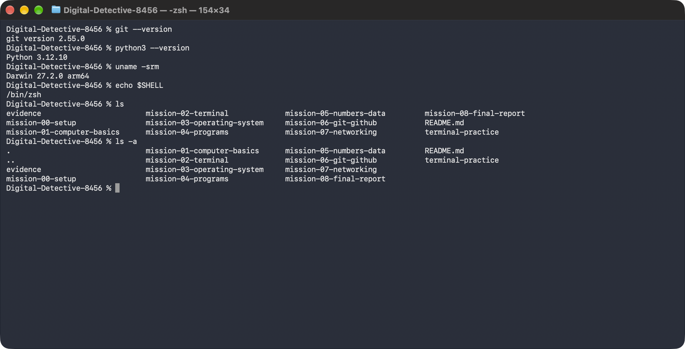
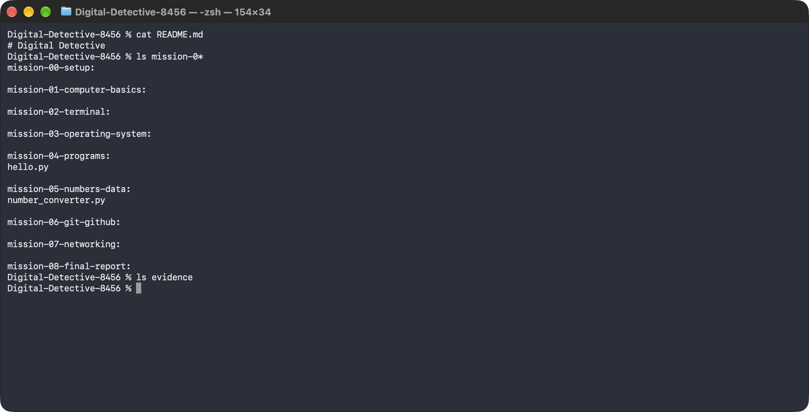
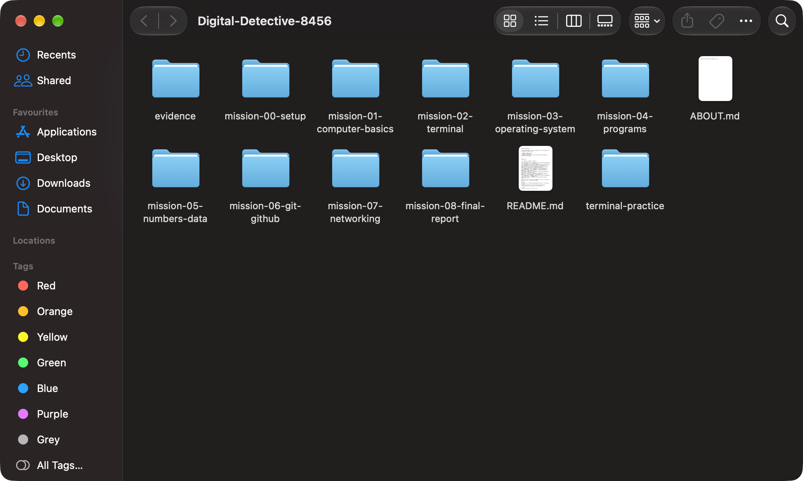
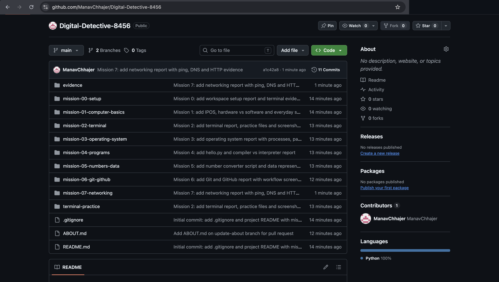

# Mission 0: Setting Up My GitHub Workspace

## 1. At a glance
- **Assignment:** The Digital Detective (Diwali Independent Learning Assignment)
- **Goal:** Create a correctly named public repository and a clean folder layout for every mission.
- **Repository name:** `Digital-Detective-8456` (8456 = last four digits of my USN)
- **GitHub URL:** `https://github.com/ManavChhajer/Digital-Detective-8456`
- **Privacy:** No username, email, device name, serial number, Wi-Fi name or IP address appears in this repo.

---

## 2. What I did
1. Named the repository using the required pattern.
2. Created a local project folder and linked it to the repo.
3. Created one folder per mission (`mission-00-setup` to `mission-08-final-report`) plus `evidence/`.
4. Added a `README.md` to the root and to every mission folder.
5. Checked that Git and Python work.
6. Pushed everything to the `main` branch on GitHub.

---

## 3. Tools I checked

| Tool | Command | Result |
| :--- | :--- | :--- |
| Git | `git --version` | `git version 2.55.0` |
| Python | `python3 --version` | `Python 3.12.10` |
| System | `uname -srm` | `Darwin 27.2.0 arm64` |
| Shell | `echo $SHELL` | `/bin/zsh` |

---

## 4. Folder layout

```text
Digital-Detective-8456/
├── README.md                    project overview and mission index
├── .gitignore                   keeps junk like .DS_Store out of Git
├── evidence/                    privacy-safe screenshots
├── mission-00-setup/            this report
├── mission-01-computer-basics/  IPOS, hardware, software
├── mission-02-terminal/         terminal practice
├── mission-03-operating-system/ processes, paths, permissions
├── mission-04-programs/         hello.py, compilers vs interpreters
├── mission-05-numbers-data/     number systems and number_converter.py
├── mission-06-git-github/       branches and pull request
├── mission-07-networking/       networking commands and notes
└── mission-08-final-report/     summary and checklist
```

---

## 5. Ideas I needed to understand

### What is a repository?
A repository is a project folder whose history Git remembers. It has three parts:
- **Working folder:** the files I see and edit.
- **Staging area:** where I choose which changes go into the next save point.
- **`.git` folder:** the hidden database of every commit.

Pushing to GitHub adds an online copy that works as a backup and makes sharing easy.

### Why one folder per mission?
- Each mission is about a different topic, so keeping them apart avoids mess.
- I can commit after each mission, which gives a clear history of my progress.
- A reviewer can jump straight to the mission and its evidence.

---

## 6. Problems and fixes

| Problem | What I learned | Fix |
| :--- | :--- | :--- |
| Empty folders did not appear in Git | Git tracks files, not empty folders | Put a `README.md` in every mission folder |
| Not sure the wildcard `touch */README.md` made all files | Wildcards can hide mistakes | Checked with `ls -la` in each folder |
| Terminal prompts show my username | Screenshots can leak personal data | Cropped or blurred them before adding to `evidence/` |

---

## 7. Evidence

### Evidence 1: tool check and folder listing
Git, Python, system and shell versions, plus the project folders.



### Evidence 2: README check
Contents of each mission folder.



### Evidence 3: Finder view
The project folder in Finder. *(add my own screenshot as `Mission-00-03.png`)*



### Evidence 4: GitHub repository
The public repository page. *(add my own screenshot as `Mission-00-04.png`)*


