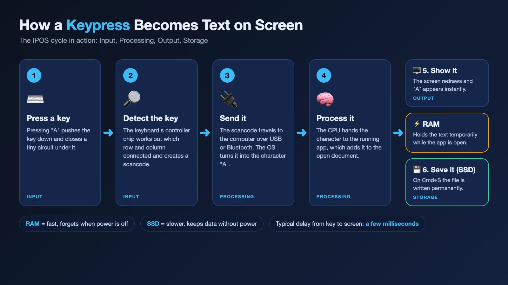
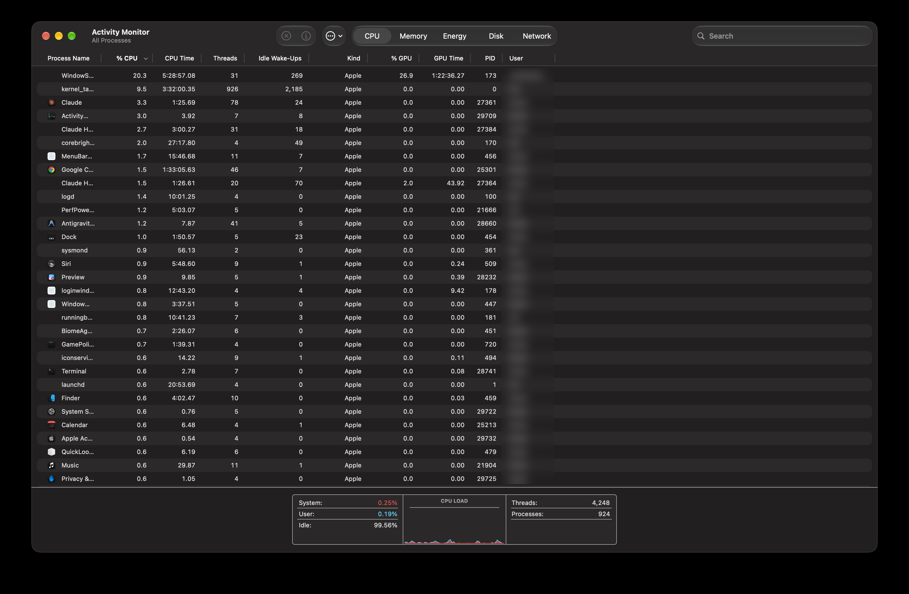
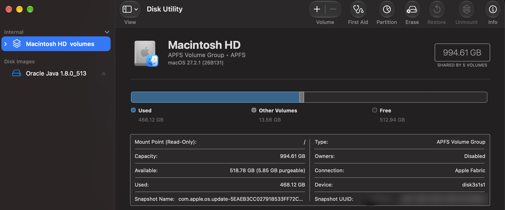

# Mission 1: Know Your Computer

## 1. What this mission covers
- How a computer handles any task through the **IPOS** cycle: Input, Processing, Output, Storage.
- Sorting things into hardware, operating system, application software and utility software.
- Spotting small computers hidden inside everyday machines.

My machine for reference: a MacBook Pro with an Apple M5 Pro chip, 24 GB of memory and a 64-bit ARM (`arm64`) processor. Serial numbers, usernames and network addresses are left out.

---

## 2. Task 1.1: Following one activity through IPOS

**Activity I chose:** typing a line of code in an editor and saving the file.

| Stage | What happens | Parts involved |
| :--- | :--- | :--- |
| **Input** | I press a key. The keyboard notices which switch closed and sends a small code for that key to the computer. | Keyboard, its controller chip, USB or Bluetooth link |
| **Processing** | The OS passes the code to the editor, which decides which character it is and puts it in the document held in memory. The CPU runs these steps in a tiny fraction of a second. | CPU, RAM, operating system |
| **Output** | The editor asks the graphics hardware to redraw the text. The new letter appears on the screen almost instantly. | GPU, display |
| **Storage** | When I press `Cmd+S`, the OS writes the document from RAM to the drive so it survives a shutdown. | SSD, file system |



*Figure 1.1: A keypress travelling from the keyboard to the screen and the drive.*

**The key point:** until I save, my text lives only in RAM, which empties when power is lost. Saving copies it to the SSD, which keeps data without power. That is the main difference between memory and storage.

---

## 3. Task 1.2: Hardware or software?

Hardware is anything you can touch. Software is the instructions that tell hardware what to do, and it comes in three main kinds:
- **Operating system:** controls the hardware and shares it between programs.
- **Application:** helps a user get a specific job done.
- **Utility:** looks after the computer by monitoring, repairing and cleaning.

| Item | Hardware / Software | Type | What it does |
| :--- | :---: | :--- | :--- |
| Keyboard | Hardware | n/a | Turns key presses into signals |
| CPU | Hardware | n/a | Carries out instructions |
| RAM | Hardware | n/a | Fast, temporary working space |
| SSD | Hardware | n/a | Keeps files when the power is off |
| Display | Hardware | n/a | Shows what the computer produces |
| macOS | Software | Operating system | Manages hardware, memory, files and security |
| Visual Studio Code | Software | Application | Edit and debug code |
| Web browser | Software | Application | Loads and shows web pages |
| Disk Utility | Software | Utility | Checks, repairs and formats drives |
| Activity Monitor | Software | Utility | Shows running programs and resource use |

---

## 4. Task 1.3: Computers in everyday life

| Machine | Purpose | Main input | Main output |
| :--- | :--- | :--- | :--- |
| ATM | Banking without a cashier | Card reader and PIN pad | Cash and receipt |
| Traffic signal controller | Keeps road junctions safe and moving | Sensors that detect waiting vehicles | Red, amber and green lights |
| Metro ticket machine | Sells tickets and recharges travel cards | Touchscreen choices and payment | Ticket or card update |

**Notes**
- An ATM uses a small, locked-down computer with security hardware for PIN checking and cash handling.
- A traffic controller follows fixed rules and changes the lights when its sensors report traffic.
- A ticket machine combines a touchscreen, a payment unit and a printer under one program.

None of these look like a "computer", yet each one takes input, processes it, produces output and stores records.

---

## 5. Commands and tools I used
```bash
uname -a            # kernel and architecture
python3 --version   # Python 3.12.10
git --version       # git 2.55.0
```
I also opened **Activity Monitor** (live memory and process use) and **Disk Utility** (drive layout).

---

## 6. What I learned
- Everything a computer does, from a video call to a game, is the same IPOS loop repeated.
- RAM is fast but temporary; the SSD is slower but permanent.
- Utilities are programs that look after the system; they are not the OS itself.

**A difficulty:** I mixed up the OS and utilities at first. It helped to think of the OS as the manager of the computer and utilities as the maintenance crew.

---

## 7. Evidence

### Keypress to screen and storage


### Activity Monitor
Live processes and memory use. My username is blurred.



### Disk Utility
My drive and its APFS container. Identifiers are blurred.


