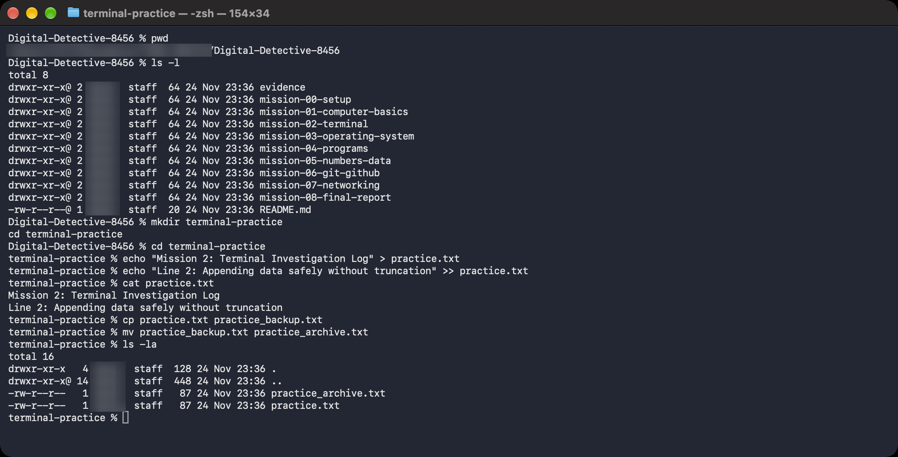
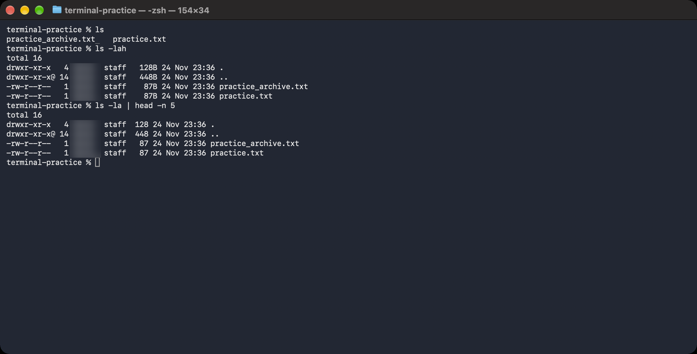
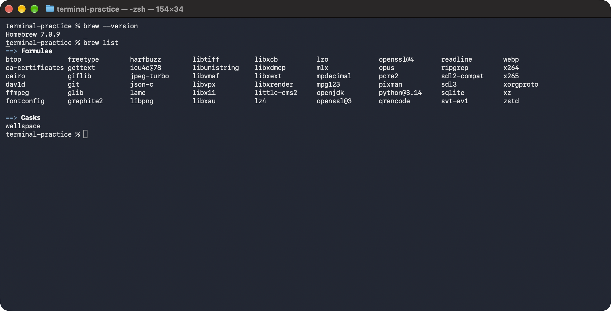

# Mission 2: Getting Comfortable with the Terminal

## 1. Overview
- **Assignment:** The Digital Detective (Diwali Independent Learning Assignment)
- **Goal:** Get confident using the command line: moving around, creating and editing files safely, using flags and pipes, and checking the package manager.
- **Privacy:** Usernames, hostnames, IP addresses and Wi-Fi names are removed from everything shown here.

All practice happened inside the project folder `Digital-Detective-8456`.

---

## 2. Task 2.1: Everyday commands

| Task | Command | What it does | What I saw |
| :--- | :--- | :--- | :--- |
| Show where I am | `pwd` | Prints the full path of my current folder | `/Users/<me>/Documents/Digital-Detective-8456` |
| List contents | `ls` | Shows files and folders | The mission folders, `README.md` and `evidence/` |
| Detailed list | `ls -l` | Adds permissions, owner, size and date | `drwxr-xr-x` for folders, `-rw-r--r--` for files |
| Go up / into a folder | `cd ..` and `cd <folder>` | Changes my location | `pwd` confirmed each move |
| Make a folder | `mkdir terminal-practice` | Creates a directory | No message, which means success |
| Make an empty file | `touch practice.txt` | Creates a 0-byte file | A new empty file appeared |
| Copy | `cp practice.txt practice_backup.txt` | Duplicates a file | Both files existed |
| Move or rename | `mv practice_backup.txt practice_archive.txt` | Renames the file | The old name was gone |
| Read a file | `cat practice.txt` | Prints the file's text | My two lines appeared |

---

## 3. Task 2.2: Changing files safely

I worked in a separate `terminal-practice/` folder so nothing important could be damaged.

```bash
mkdir terminal-practice && cd terminal-practice
echo "Mission 2: Terminal Investigation Log" > practice.txt
echo "Line 2: Appending data safely without truncation" >> practice.txt
cat practice.txt
cp practice.txt practice_backup.txt
mv practice_backup.txt practice_archive.txt
```

Result of `cat practice.txt`:
```text
Mission 2: Terminal Investigation Log
Line 2: Appending data safely without truncation
```

### Questions

**1. Replacing text vs adding to the end**
`>` empties the file first and then writes, so earlier content is lost. `>>` keeps what is there and adds the new text after it.

**2. Copying vs moving**
`cp` produces a second, independent file while the first stays. `mv` leaves only one file, either renamed or in a new place. On the same drive it is instant because no data is copied.

**3. What `pwd` tells me**
The exact folder I am in. Checking it first prevents running a delete or overwrite in the wrong place.

**4. Why `ls` is useful**
It shows what exists, how files are spelled, their sizes and permissions, and (with `-a`) hidden files like `.gitignore`.

---

## 4. Task 2.3: Flags and pipes

### Flags
A flag changes how a command behaves.

| Command | Effect |
| :--- | :--- |
| `ls` | Plain list of names |
| `ls -l` | Long list with permissions, owner, size, date |
| `ls -a` | Includes hidden files, including `.` and `..` |
| `ls -lh` | Long list with sizes like `576B` or `1.2K` |
| `ls -lah` | All of the above together |

### Pipes
A pipe `|` sends the output of one command straight into another, with no temporary file.

```bash
ls -la | head -n 5
```
- `ls -la` lists everything, including hidden files.
- `head -n 5` keeps only the first five lines: the total, `.`, `..`, then the next two entries.

---

## 5. Task 2.4: Package manager

A package manager installs, updates and removes software for me. It also installs everything that software depends on and checks that downloads are genuine. On macOS the common one is **Homebrew**. I only looked at it and installed nothing.

| Check | Command | Result |
| :--- | :--- | :--- |
| Version | `brew --version` | `Homebrew 7.0.9` |
| Command-line tools | `brew list --formulae` | Includes `btop`, `ffmpeg`, `git`, `ca-certificates` |
| Apps | `brew list --casks` | `wallspace` |

---

## 6. Evidence

### Evidence 1: file operations and redirection
`pwd`, `ls -l`, `mkdir`, `>`, `>>`, `cat`, `cp`, `mv`, `ls -la`.



### Evidence 2: flags and pipes
`ls`, `ls -lah`, `ls -la | head -n 5`.



### Evidence 3: package manager
`brew --version` and `brew list`.



---

## 7. Reflections
- **Redirect vs pipe:** `>` sends output to a file, `|` sends it to another program. I kept mixing them up until I wrote both down side by side.
- **Overwrite risk:** typing `>` instead of `>>` can erase a file, so I now copy important files first.
- **Privacy:** I checked every screenshot for my username before adding it.
