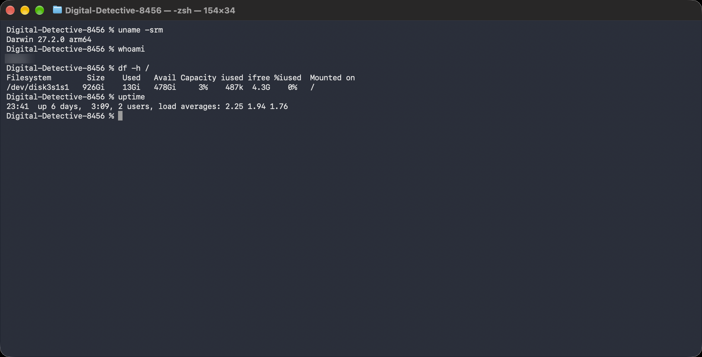
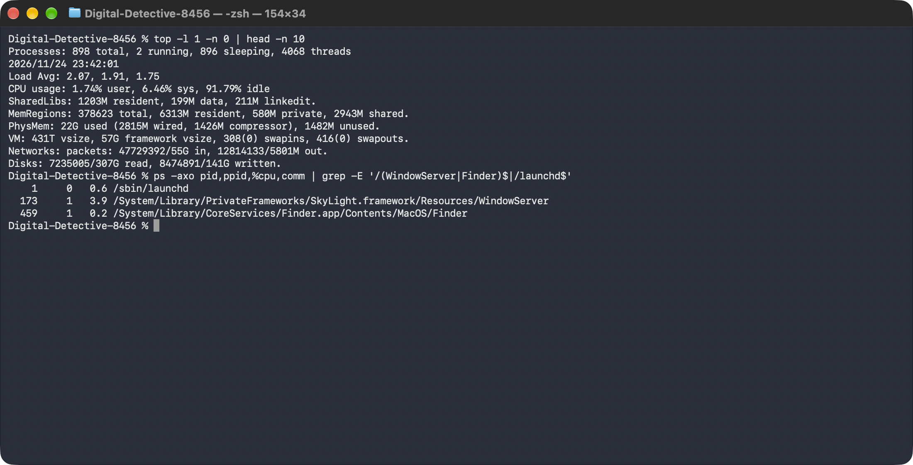
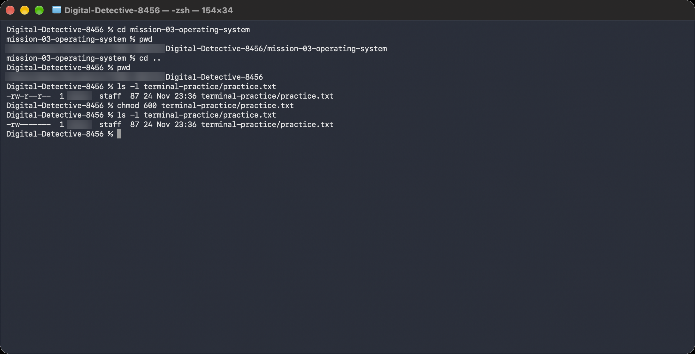

# Mission 3: Looking Inside the Operating System

## 1. Goal
Find out what my operating system is doing: which kernel it runs, how much storage is left, which processes are active, how file paths and permissions work, and what jobs an OS performs. Usernames and hostnames are replaced with `<me>`.

---

## 2. Exploring my system

| What I checked | Command | What it shows | My result |
| :--- | :--- | :--- | :--- |
| Kernel and CPU type | `uname -srm` | OS name, kernel version, architecture | `Darwin 27.2.0 arm64` (Apple Silicon) |
| Who I am | `whoami` | Account running the shell | `<me>`, a normal user, not root |
| Disk space | `df -h /` | Size, used and free space of the main volume | 926Gi total, 13Gi used, 478Gi free, 3% full |
| Current activity | `top -l 1 -n 0` | Process count, CPU and memory use | 898 processes (2 running, 896 sleeping), CPU 91.79% idle, 22G RAM used |
| Uptime | `uptime` | How long the Mac has been on and its load | Up 6 days 3 h 9 min, load averages 2.25 / 1.94 / 1.76 |

---

## 3. Processes

**What is a process?** A program that is currently running. The program file sits on disk; once started, the OS gives it memory, CPU time and a place in its process table.

**What is a PID?** A number the kernel gives each process so it can be found, scheduled and, if needed, stopped. Each process also records its parent's number (PPID).

**Processes I found with `ps -eo pid,ppid,%cpu,comm`:**

| PID | PPID | Process | Kind | Job |
| :-: | :-: | :--- | :--- | :--- |
| 1 | 0 | `launchd` | system | The first process; it starts and supervises others |
| 173 | 1 | `WindowServer` | system | Draws every window on the screen |
| 459 | 1 | `Finder` | app | The file browser and desktop |

Both `WindowServer` and `Finder` have PPID 1, so `launchd` started them.

---

## 4. Paths and permissions

**Absolute path:** starts at `/` and works from anywhere.
`/Users/<me>/Documents/Digital-Detective-8456/mission-03-operating-system`

**Relative path:** depends on where I currently am.
From the project folder: `./mission-03-operating-system`. From inside a mission folder: `../terminal-practice/practice.txt`.

**Reading a permission string** from `ls -l terminal-practice/practice.txt`:
```text
-rw-r--r--  1 <me>  staff  87 24 Nov 23:36 terminal-practice/practice.txt
```

| Part | Meaning |
| :-: | :--- |
| `-` | Regular file (a folder would show `d`) |
| `rw-` | Owner can read and write, but not execute |
| `r--` | Group `staff` can only read |
| `r--` | Everyone else can only read |

On a folder, `x` means "allowed to enter it". On a file, it means "allowed to run it".

Small experiment (I ran this):
```bash
chmod 600 terminal-practice/practice.txt
ls -l terminal-practice/practice.txt
```
Before: `-rw-r--r--`. After: `-rw-------`, so now only I can read or write the file.

---

## 5. What an OS is responsible for

| Responsibility | In my words | Example from my Mac |
| :--- | :--- | :--- |
| Processes | Decides which program gets the CPU and for how long | Browser, editor and music player all run together |
| Memory | Hands out RAM and keeps programs from touching each other's memory | One app crashing does not take down the rest |
| Devices | Uses drivers to talk to hardware | Sound plays through speakers or Bluetooth headphones |
| Files | Organises data on the SSD | APFS stores `practice.txt` and tracks its size and dates |
| Interface | Lets me give commands by windows or text | Finder and Dock, or `zsh` in Terminal |
| Security | Checks who may do what | Installing software asks for my password or Touch ID |

---

## 6. Evidence

### Evidence 1: OS and storage
`uname -srm`, `whoami`, `df -h /`, `uptime`.



### Evidence 2: processes
`top -l 1 -n 0` and `ps -eo pid,ppid,%cpu,comm`.



### Evidence 3: paths and permissions
`pwd`, `cd`, `ls -l`.



---

## 7. Reflections
- My Mac runs hundreds of processes while the CPU is mostly idle, which shows how well the scheduler shares time.
- Almost everything on screen traces back to PID 1.
- The `x` permission means something different on a folder than on a file, which I had not realised before.
