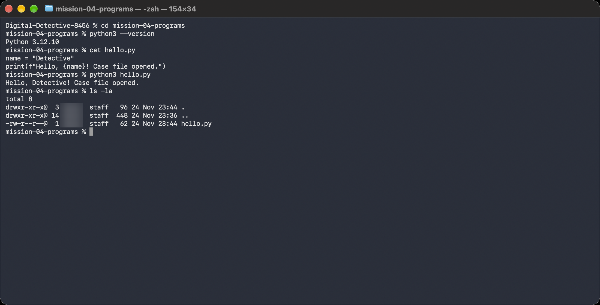

# Mission 4: How Programs Run

## 1. Goal
Write and run a small Python program from the terminal, then compare compilers with interpreters. My username is not shown anywhere.

---

## 2. My program

`hello.py`:
```python
name = "Detective"
print(f"Hello, {name}! Case file opened.")
```

Commands and output:
```bash
python3 --version     # Python 3.12.10
cat hello.py
python3 hello.py      # Hello, Detective! Case file opened.
ls -la                # shows hello.py at 62 bytes
```

What happened: Python read my file, turned it into bytecode, and its virtual machine executed that bytecode and printed the text.

---

## 3. Compiler vs interpreter

| Point | Compiler | Interpreter |
| :--- | :--- | :--- |
| Timing | Translates everything before the program runs | Translates while the program runs |
| Result | A separate executable file | No separate file, just the program's behaviour |
| Examples | `gcc`, `clang`, `rustc` | `python3`, Node.js, `zsh` |
| Strength | Fast at run time and finds many errors early | Quick to edit and test, runs wherever the interpreter exists |
| Weakness | Must rebuild after every change | Usually slower |

In short: a compiler is like translating a whole book before anyone reads it. An interpreter is like a live translator who speaks sentence by sentence.

---

## 4. Python does a bit of both

1. **Compile step:** CPython converts the source into bytecode (cached as `.pyc` in `__pycache__`).
2. **Run step:** The Python Virtual Machine executes that bytecode.

I can look at the bytecode with:
```bash
python3 -m dis hello.py
```

---

## 5. Evidence



Shows `python3 --version`, `cat hello.py` and `python3 hello.py`.

---

## 6. Reflections
- Processors only understand machine instructions, so some translator always sits between my code and the CPU.
- Compiled programs are tied to a CPU type, while Python code runs anywhere Python is installed.
- Learning about bytecode cleared up why Python is not "purely" interpreted.
