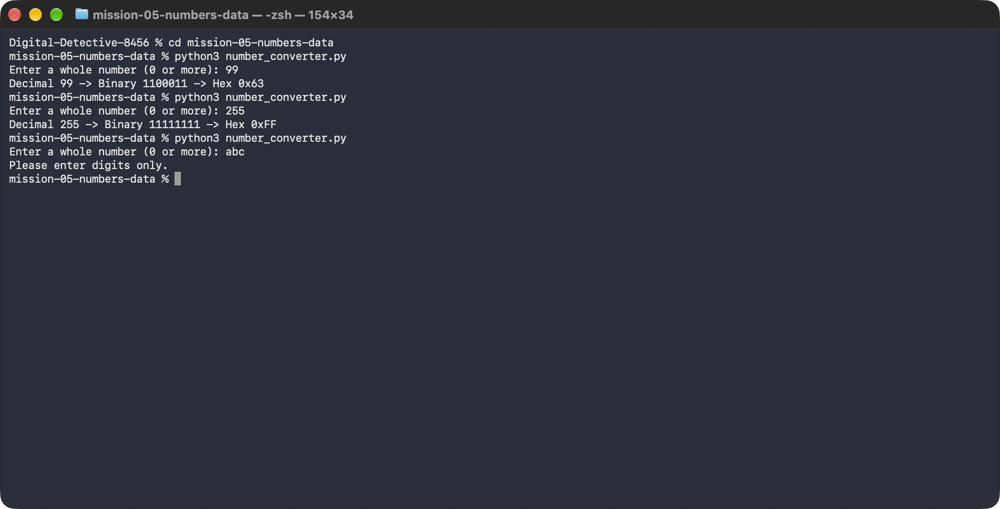

# Mission 5: Numbers and Data

## 1. Goal
Understand how computers store numbers and text, convert between decimal, binary and hexadecimal by hand, and check the results with a small Python tool.

---

## 2. Number systems

| System | Base | Digits | Where it appears |
| :--- | :-: | :--- | :--- |
| Decimal | 10 | 0-9 | Everyday counting |
| Binary | 2 | 0, 1 | What the hardware uses |
| Hexadecimal | 16 | 0-9, A-F | Colours, memory addresses, compact binary |

One hex digit equals exactly four bits, so a byte (8 bits) is always two hex digits.

---

## 3. Conversions by hand

### Decimal to binary (subtract powers of two)

| Decimal | Working | Binary | Hex |
| :-: | :--- | :-: | :-: |
| 45 | 32 + 8 + 4 + 1 | `101101` | `0x2D` |
| 99 | 64 + 32 + 2 + 1 | `1100011` | `0x63` |
| 200 | 128 + 64 + 8 | `11001000` | `0xC8` |
| 255 | 128 + 64 + 32 + 16 + 8 + 4 + 2 + 1 | `11111111` | `0xFF` |

### Back to decimal
- Binary `1010` = 8 + 2 = **10**
- Hex `0x1F` = 1 x 16 + 15 = **31**

### Binary to hex shortcut
Split into groups of four bits: `1100 0011` becomes `C` and `3`, so the answer is `0xC3`.

---

## 4. Text as numbers

| Character | Decimal (ASCII) | Binary |
| :-: | :-: | :-: |
| `A` | 65 | `01000001` |
| `a` | 97 | `01100001` |
| `D` | 68 | `01000100` |

- **ASCII** uses 7 bits per character and covers English letters, digits and symbols.
- **UTF-8** uses 1 to 4 bytes per character. It matches ASCII for the first 128 characters, so old text still works, and it can also store other scripts. For example `₹` (U+20B9) takes three bytes: `E2 82 B9`.

---

## 5. My converter: `number_converter.py`

The script reads a whole number, rejects anything that is not digits, and prints binary and hex.

```bash
cd mission-05-numbers-data
python3 number_converter.py
```

Results I got:

| Input | Output |
| :-: | :--- |
| `99` | Binary `1100011`, Hex `0x63` |
| `255` | Binary `11111111`, Hex `0xFF` |
| `abc` | `Please enter digits only.` |

These match my hand calculations above.

---

## 6. Evidence



Running the converter with `99`, `255` and an invalid input.

---

## 7. Reflections
- Hex is just a shorter way of writing binary, which is why programmers like it.
- Working each conversion by hand first and then checking it with the script gave the same answer every time.
- A computer has no idea what "A" is; it only stores the number 65 and a program decides to show it as a letter.
