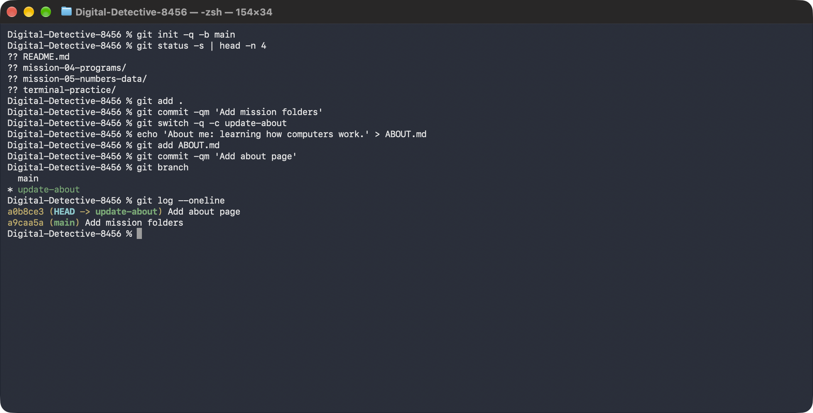
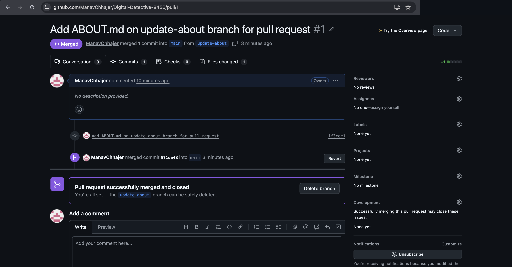

# Mission 6: Git and GitHub

## 1. Goal
Practise the everyday Git workflow: stage, commit, branch, push and open a pull request.

- **Repository:** `https://github.com/ManavChhajer/Digital-Detective-8456`
- **Pull request:** `https://github.com/ManavChhajer/Digital-Detective-8456/pull/1`

---

## 2. The three areas of Git

| Area | What it is | Command that moves things |
| :--- | :--- | :--- |
| Working folder | The files I edit | n/a |
| Staging area | Changes picked for the next commit | `git add` |
| Repository | Saved history | `git commit` |

**Staging vs committing:** staging chooses *what* goes into the next snapshot; committing actually saves the snapshot with a message.

---

## 3. Commands I used

```bash
git init -b main                 # start a repository
git add .                        # stage everything
git commit -m "Add mission folders"
git switch -c update-about       # new branch for a small change
echo "About me: learning how computers work." > ABOUT.md
git add ABOUT.md
git commit -m "Add about page"
git branch                       # list branches
git log --oneline                # short history
git push -u origin update-about  # send the branch to GitHub
```

What `git log --oneline` showed: two commits, `Add mission folders` on `main` and `Add about page` on `update-about`.

---

## 4. Pull request steps
1. Push the `update-about` branch to GitHub.
2. On the repository page, click **Compare & pull request**.
3. Write a short title and description, then **Create pull request**.
4. Review the changed files, then **Merge pull request**.
5. Run `git switch main` and `git pull` to bring the merged result back.

---

## 5. Glossary (my words)

| Term | Meaning |
| :--- | :--- |
| Clone | Download a copy of a repository |
| Branch | A separate line of work |
| Commit | A saved snapshot with a message |
| Push | Send my commits to GitHub |
| Pull | Bring GitHub's newest commits to my computer |
| Merge | Combine one branch into another |
| Pull request | A request to merge, with a chance to review |

---

## 6. Evidence

### Evidence 1: local Git workflow
`git init`, `git add`, `git commit`, `git switch -c`, `git branch`, `git log --oneline`.



### Evidence 2: pull request on GitHub
*(add my own screenshot as `Mission-06-02.png`)*



---

## 7. Reflections
- A branch lets me try something without touching `main`.
- Small commits with clear messages make history easy to read.
- A pull request is useful even when working alone, because it shows exactly what changed.
