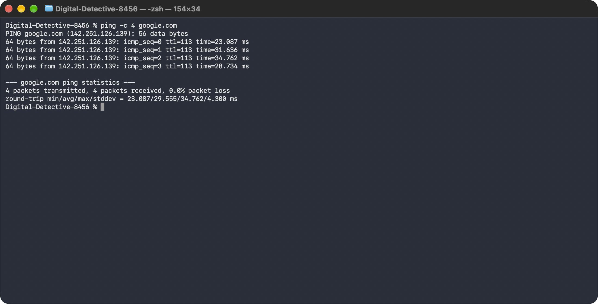
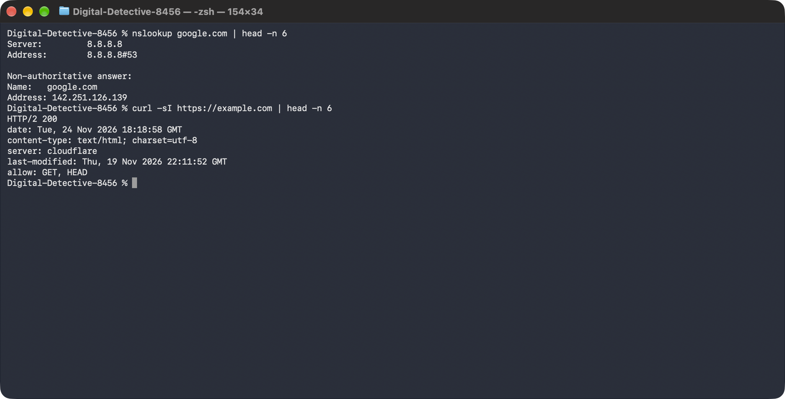

# Mission 7: Networking and the Web

## 1. Goal
Understand how computers connect, how names turn into addresses, and what happens when a website opens. Local addresses and Wi-Fi names are not shown.

---

## 2. Types of networks

| Type | Area | Example |
| :--- | :--- | :--- |
| LAN | One home, school or office | My home Wi-Fi |
| MAN | A city | A city-wide fibre network |
| WAN | Countries and continents | The Internet |

**Router:** passes data between networks and decides the next hop for each packet.
**DNS:** the Internet's phone book, turning names like `google.com` into IP addresses.
**Packet switching:** data is cut into small packets that may take different routes and are reassembled at the end.

---

## 3. What I tested

| Test | Command | What it shows |
| :--- | :--- | :--- |
| Reachability and delay | `ping -c 4 google.com` | Whether the server answers and how fast |
| Name lookup | `nslookup google.com` | Which IP address DNS returns |
| Web request | `curl -sI https://example.com` | The server's reply headers |

### My results
- **Ping:** 4 packets sent, 4 received, 0% loss. Round trip averaged about 29.6 ms (min 23.1, max 34.8).
- **DNS:** My computer asked the DNS server `8.8.8.8`, which answered with an address in `142.251.126.x` for `google.com`.
- **HTTP:** `curl` to `example.com` returned `HTTP/2 200` (success), content type `text/html`, served by `cloudflare`.

Results change between runs; an earlier ping test on a weaker connection lost half its packets and varied from 24 to 174 ms.

---

## 4. What happens when I open a website
1. **Type the address** in the browser.
2. **DNS lookup** finds the server's IP address.
3. **TCP connection** is set up with the server.
4. **TLS handshake** encrypts the connection (the padlock for HTTPS).
5. **HTTP request** asks for the page.
6. **Response and rendering:** the server sends HTML, CSS and images, and the browser draws the page.

---

## 5. Evidence

### Evidence 1: ping

### Evidence 2: DNS lookup and HTTP headers

---

## 6. Reflections
- A fast ping does not mean a page will load fast, because many steps happen after the connection.
- DNS is a single point that every request depends on, so a DNS problem looks like "the Internet is down".
- The 200 status code means the server understood and answered successfully.
